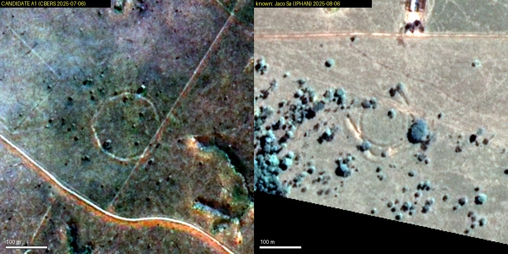

# A ring 156 m across in cleared land near Boca do Acre, Brazil

Status: **candidate**, about even odds. It has the plan of an Acre-type geoglyph, and a modern origin
cannot be ruled out from imagery. Produced with AI assistance; see the repository README. Nothing has
been reported to anyone.

**The location is withheld**, as for every possible archaeological site in this repository.

## What was done

The geometric earthworks ("geoglyphs") of Acre and southern Amazonas were built under forest and
become visible when the forest is cleared. About 3,700 km² of land cleared since 2001 (from the Hansen
forest-loss maps) in three sectors was examined in CBERS-4A imagery sharpened to 2 m and in Sentinel-2
imagery, year by year. The method was first shown to work on known sites: Jacó Sá and Fazenda Colorada
are plain in both image sets.

Most ring-like things found were not earthworks: bright-rimmed rings 20 to 40 m across are cattle
ponds, dark curving bands are old river channels, and round dark patches in burnt forest are shadows.

## The candidate

*Left: the candidate, CBERS-4A, July 2025. Right: the registered geoglyph Jacó Sá at the same scale,
August 2025. Scale bars 100 m.*

- A closed ring, slightly polygonal, 156 m across (circle fitted to 622 pixels of the line).
- The line is pale and thin, about 8 m wide (give or take 4 m), as a filled ditch looks in pasture.
- It is in the same place on all ten CBERS-4A dates checked from June 2023 to September 2025.
- In Sentinel-2 it is hidden under regrowth from 2017 to 2020, faint in August 2021 after a fresh
  clearing and burn, and clear every dry season from 2022 to 2026.
- It ignores the straight fence line 100 m to its east.

## Not found in

| source | nearest entry |
|---|---|
| IPHAN's national register of sites (SICG, points and polygons) | 28.8 km |
| Peripato et al. 2023 (*Science*), database of 961 earthworks | 5.9 km |
| OpenStreetMap archaeological sites | 5.8 km |
| Wikidata archaeological sites | 102 km |

## Why it is only a candidate

- **One feature, outline only.** No outer bank, second enclosure or avenue is resolved at 2 m.
- **It first shows right after the 2020 to 2021 clearing.** A ring track, a firebreak or a cattle path
  round a paddock made at that time would look much the same. Against that: the outline has not changed
  in five dry seasons and its width is constant.
- **Low contrast**, so the width is approximate.
- **The lists are incomplete** for southern Amazonas, and recent survey work may not be in them.

## Who could settle it

IPHAN (the superintendencies for Acre and Amazonas) can compare it with the full register. A drone or
lidar terrain model would show whether there is a sunken ditch with a bank; a field visit would settle
it.

## Data and credits

CBERS-4A WPM imagery: INPE, Brazil (CC BY-SA 4.0). Sentinel-2: contains modified Copernicus Sentinel
data, 2017 to 2026. Forest loss: Hansen et al., Global Forest Change. Site lists: IPHAN SICG; Peripato
et al. 2023; OpenStreetMap contributors; Wikidata.
