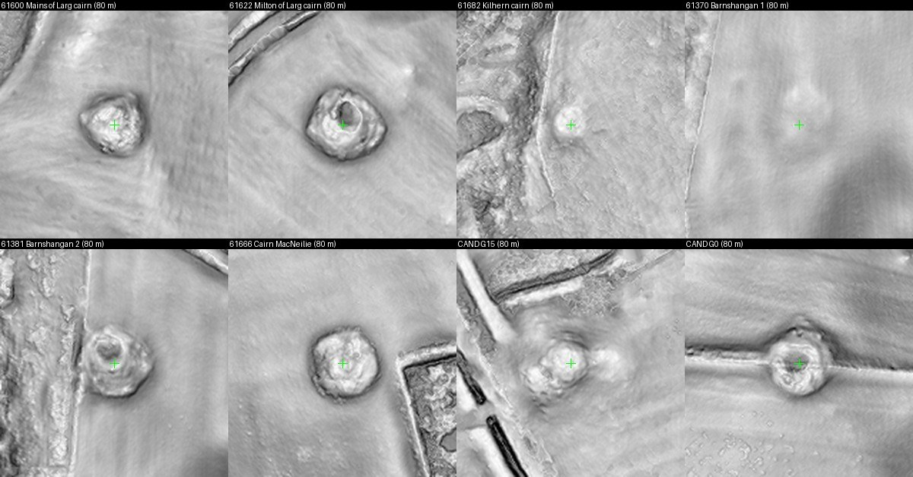

# Two possible robbed cairns in Galloway, Scotland

Status: **candidates**, weak. Two mounds that look like recorded cairns nearby and have no record at
their position. Produced with AI assistance; see the repository README. Nothing has been reported to
anyone.

**The locations are withheld**, as for every possible archaeological site in this repository.

## What was done

The Scottish Government's open lidar terrain models were searched for small round mounds and ring
banks in parts of Galloway, Kintyre and Angus. Automatic detectors covered about 1,370 km². The visual
pass that followed covered only about 25 of roughly 170 overview sheets, so most of the area was not
looked at by eye. Each suspect was compared with Historic Environment Scotland's Canmore record, the
scheduled monuments layer and the first-edition Ordnance Survey six-inch map (1860s).

## The two candidates

*Top row and the first two panels of the bottom row: six cairns recorded in Canmore, with their record
numbers. Last two panels: the candidates. Each panel is 80 m across.*

| | first candidate | second candidate |
|---|---|---|
| form | stony mound with a hollowed top, on a low natural rise | ring-shaped stony mound with a central hollow, built into a field wall |
| size | 13 to 14 m across, 1.5 to 2.0 m high | 16 to 18 m across, rim 0.6 to 0.8 m above the hollow |
| nearest Canmore record | farmsteads at 259 m and 361 m; nearest cairn 1.8 km | a building at 315 m; an unlocated cairn record about 1 km away |
| 1860s map | nothing marked at the spot; a "Cairn" is named 410 m away | field wall shown, nothing named |
| in a second lidar survey | not checked | yes, identical in two surveys years apart |
| agent's confidence | 0.4 | 0.45 |

## Why these are weak

- A hollow-topped mound can also be a field-clearance heap, a natural knoll with stones, a lime kiln
  or a fenced tree clump.
- The second candidate lies inside the area swept by the 2020 "Machars Waterborne" volunteer lidar
  project, so it may already be on that project's list or in the council's record. The unlocated
  cairn record near it could be the same thing.
- The Dumfries and Galloway historic environment record and the Ordnance Survey name books were not
  checked.

Two weaker leads from the same search, a group of very low mounds in Angus and an oval ring bank in
Kintyre, were rated 0.2 and are not described further. Five suspects that turned out not to be sites are filed as a
[dead end](../../../dead-ends/archaeology/scottish-lidar-lookalikes/README.md).

## Who could settle it

Historic Environment Scotland (Canmore) and the Dumfries and Galloway Council archaeology service.

## Data and credits

Lidar: Scottish Government, Scottish Remote Sensing Portal, Open Government Licence v3.0. Site
records: Historic Environment Scotland (Canmore). Historic maps: National Library of Scotland.
