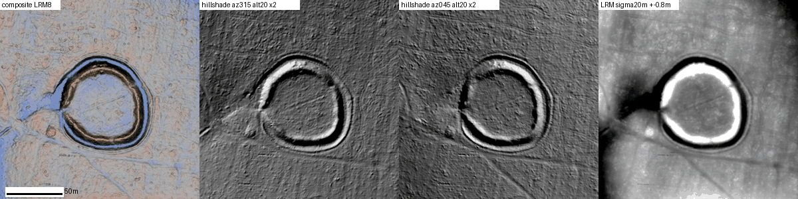
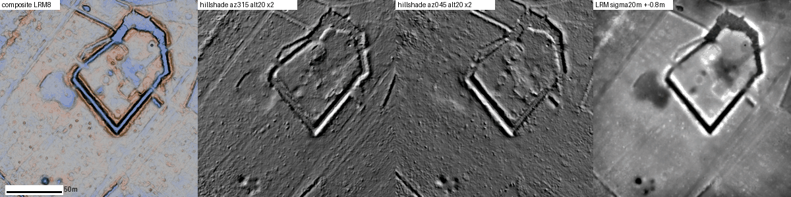

# A ring earthwork under forest in northern Yonne, France

Status: **candidate**. A real earthwork, undated, absent from the open sources that could be searched.
The official French sites register is not public, so it may already be recorded. Produced with AI
assistance; see the repository README. Nothing has been reported to anyone.

**The location is withheld**, as for every possible archaeological site in this repository.

## What was done

Hillshade and local-relief images from IGN's open LiDAR HD terrain model were swept over about
1,070 km² of forest in three regions (the Pays d'Othe in Yonne and Aube, the forests north of Nevers,
and the Bessède forest in Périgord). The sweep was calibrated on known sites first: it showed the Camp
de Barcena and a recorded ring enclosure in the Othe, a recorded moated castle north of Nevers, and
the Camp de César promontory fort in Périgord.

## The main candidate

*The same square, about 170 m on a side, in four renderings of the bare-earth model. Scale bar 50 m.
Source: IGN LiDAR HD.*

A circular bank with an outer ditch on a wooded hilltop.

- Outer diameter 70 to 73 m (0.4 ha); interior 45 to 50 m.
- Bank 1.5 to 2.0 m above the interior; ditch 1 to 1.5 m below the ground outside.
- A gap on the west side with what looks like a hollow way leading to it.
- At the same scale it resembles the known ring enclosure used as a control in the same forest region.

It is not drawn on the Cassini map (about 1750), the État-major map (1820 to 1866), the 1950 map or
the modern map, and the tree canopy hides it on air photographs from the 1950s and today.

## A second, weaker one

A five-sided enclosure about 52 by 58 m, with a bank and ditches, inside a system of long straight low
banks that look like old field boundaries. The sharp corners are unusual for an ancient farm
enclosure and would suit a later woodland feature just as well.

## Not found in

IGN place names (BD TOPO); OpenStreetMap historic and archaeological tags; the Mérimée heritage
database (44,504 located records); Wikidata; the four generations of maps above; French-language web
searches for the commune and the wood with the words for enclosure, motte and camp.

## Why it is only a candidate

- **No date.** A ring bank and ditch of this size can be Iron Age, medieval, or a post-medieval
  enclosure for a hunting lodge, a sheepfold or a plantation. Only fieldwork can tell.
- **The register could not be checked.** France's national record of sites (Patriarche) is closed to
  the public. "Not in open sources" does not mean unknown to the regional archaeology service.
- **Local history not read.** A medieval fief is documented in the commune, and a nineteenth-century
  local history exists that could not be reached.
- The web search tool used here returns results for the United States only, which weakens the French
  searches.

## Also seen, and set aside

A square ditched enclosure of about 1.1 ha in forest north of Nevers. The Cassini map shows a manor
300 m away and a place name with "Motte" survives beside it, so it is most likely the moat of that
deserted manor and probably known locally.

## Who could settle it

The Service régional de l'archéologie at the DRAC Bourgogne-Franche-Comté holds the register and
decides on fieldwork.

## Data and credits

Terrain model: IGN LiDAR HD, Licence Ouverte 2.0. Historic maps and air photographs: IGN Géoplateforme.
Heritage records: Ministère de la Culture (Mérimée).
