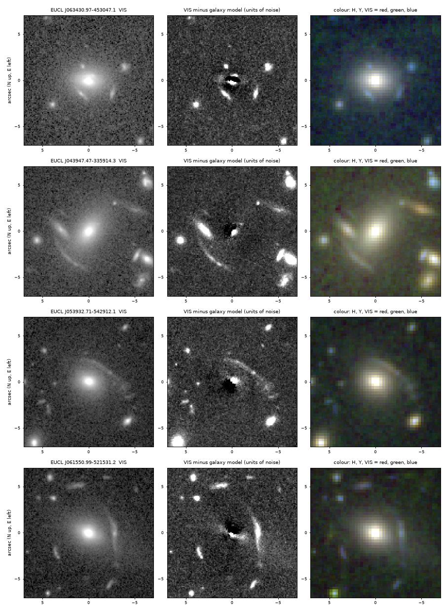
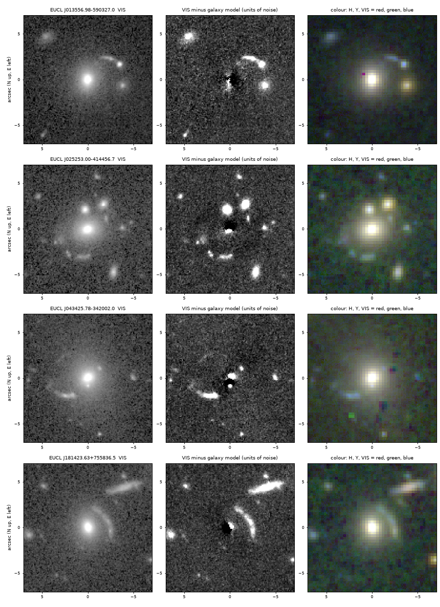

# 66 possible strong gravitational lenses in Euclid DR1 that are not in the consortium's catalogue

Status: **candidates, not confirmed.** 8 are graded B+ (one clear thin arc curved around the galaxy, or
arcs on two sides) and 58 B (arc-like but ambiguous). No spectra and no lens models. The Euclid
Consortium's own lens search scored every one of these galaxies with its neural networks, and none
passed its thresholds for inspection by its experts. Produced with AI assistance; see the repository
README.

## Source

Euclid Data Release 1 (ESA and the Euclid Consortium), public on the ESA Euclid Science Archive on
2026-11-12: catalogue tables `dr1.mer_catalogue_wide_survey`, `dr1.mer_morphology_wide_survey`,
`dr1.phz_photo_z_wide`, and the VIS, NISP-Y and NISP-H mosaics of the wide survey (9,547 tiles), read
through the archive's anonymous TAP and cutout services.

The consortium published its own strong-lens catalogue with the release: Euclid Collaboration: Lines et
al. (2026), "Euclid Lens Identification Pipeline and Scientific Exploration (ECLIPSE) A: Strong Lens
Catalogue Overview", with the data on Zenodo (doi 10.5281/zenodo.19654904). Its object catalogue has one
row for each of the 26,662 systems its experts graded (6,073 A, 8,999 B, 9,010 C, 2,580 rejected), and
its cutout catalogue has the network and volunteer scores of all 68 million galaxies it searched.

## What was done

1. **Selection.** One query selected 802,346 bright, concentrated, smooth, red galaxies in the wide survey
   (17.8 < VIS < 20.2, VIS Sersic index > 2.5, Zoobot "smooth" > 50 per cent, VIS-H > 1.15, not
   point-like). The 352 tiles of the Q1 early release were removed.
2. **Ranking by a measured lens rate.** In the Q1 fields, where several hundred grade A and B lens candidates
   are published (Euclid Collaboration: Walmsley et al. 2026 and companion lists), the fraction of
   galaxies that are lenses was fitted as a function of H magnitude, VIS-H colour, smoothness, size,
   Sersic index and ellipticity. The DR1 galaxies were ranked by this rate.
3. **Images.** VIS cutouts of the highest-ranked galaxies were fetched until the fetch stopped: 14,986
   galaxies in 1,305 tiles, about 11 per tile. This is not a complete search of any area.
4. **Grading by eye.** Every galaxy was shown as the VIS image beside the same image with a smooth model
   of the galaxy subtracted, and graded by AI vision models against a written rubric and three sheets of
   published Euclid lenses. Everything graded "possible" was graded again with a colour panel (H, Y,
   VIS). The lead model then reviewed 320 galaxies in colour and kept 157, plus 2 found beside target
   galaxies.
5. **Comparison with the consortium's catalogue.** Of those 159, 93 are in the consortium's object
   catalogue. They are on the page `independent-rediscovery/astronomy/euclid-dr1-strong-lenses`. The
   other 66 are listed here.
6. **Referee.** A separate AI model, given only the staged pages and the consortium's catalogues, redid
   the cross-match and judged the figures. Two objects were regraded from B+ to B on its advice.

## What the consortium's search did with these 66

From its cutout catalogue (every one of the 66 has a search cutout centred on it):

| | all 66 | the 8 B+ |
|---|---|---|
| flagged by its networks and shown to volunteers | 32 | 7 |
| of those, passed to a second round of volunteers | 11 | 2 |
| not flagged by its networks, so seen by nobody there | 34 | 1 |
| shown to its experts | 0 | 0 |
| in the tiles of its two early searches | 15 | 1 |

None of these was overlooked by accident: each fell below one of the consortium's thresholds. An object
went to its experts only with a first-round volunteer score above 1 - 10^-8.875, or a second-round score
above 0.87, or a very high network score (Euclid Collaboration: Holloway et al. 2026, ECLIPSE B). Among
the 32 shown to volunteers, nine scored 0.5 or more in one of the rounds and the highest second-round
score is 0.82. Among the 34 not flagged, four have a network score above 0.5, and nine lie in the tiles
of the consortium's two early searches (200 and 50 square degrees), which used preliminary networks.

All of that lowers the odds for each of the 66. The same grading, applied to the 93 objects that are in
the consortium's catalogue, agreed with its experts for 87 per cent of them, but those are objects its
pipeline had already passed, so that figure does not carry over to these. One reason some real lenses
may still be here: the consortium's search is built for galaxy-scale lenses (its typical Einstein
radius is 0.85 arc seconds, in cutouts 10 arc seconds across), while the arcs here are wider (about 3 arc
seconds from the galaxy) and sit around very luminous galaxies.

## The eight B+ candidates

Arc radius and direction (degrees, north through east) of these eight were read from the axes of the
figures below (about 0.3 arc seconds uncertain); for the B objects in `candidates.csv` the radius was
estimated by eye and is good to about 30 per cent. "Network score" is the consortium's ensemble score
(0 to 1); "volunteers" is its first-round volunteer score where the object was shown. "Blue" means bluer
than the galaxy in the colour composite. Each band is stretched separately there and NISP is coarser
than VIS, so thin features tend to look blue; colours were not measured.

| name | RA (deg) | Dec (deg) | VIS mag | photo-z | arc radius (arcsec) | network score | volunteers | what is seen |
|---|---|---|---|---|---|---|---|---|
| EUCL J063430.97-453047.1 | 98.62904 | -45.51308 | 19.8 | 0.54 | 2.0 | 0.99 | 0.00, second round 0.36 | blue arclets SE and W on opposite sides |
| EUCL J043947.47-335914.3 | 69.94779 | -33.98732 | 19.0 | 0.64 | 4.0 | 0.99 | 1.00, second round 0.52 | two long thin arcs on opposite sides both concave towards the galaxy; their colours differ so they may be two sources |
| EUCL J053932.71-542912.1 | 84.88628 | -54.48669 | 19.7 | 0.38 | 3.0 | 0.97 | 0.00 | long thin arc N to W spanning about 120 degrees |
| EUCL J061550.99-521531.2 | 93.96245 | -52.25866 | 19.6 | 0.44 | 2.8 | 0.95 | 0.08 | long thin blue arc W with arclets E and S |
| EUCL J013556.98-590327.0 | 23.98742 | -59.05749 | 18.9 | 0.41 | 3.2 | 0.92 | 0.00 | bright blue arc NW ending in a compact knot |
| EUCL J025253.00-414456.7 | 43.22083 | -41.74908 | 19.4 | 0.54 | 3.0 | 0.89 | 0.00 | thin blue knotty arc S spanning about 100 degrees |
| EUCL J043425.78-342002.0 | 68.60744 | -34.33389 | 18.8 | 0.54 | 2.3 | 0.10 | 0.00 | bright blue arc S to SE with a faint thin arc N |
| EUCL J181423.63+755836.5 | 273.59844 | +75.97682 | 19.4 | 0.34 | 2.2 | 0.00 | not shown | arc W spanning about 120 degrees |

*Left: Euclid VIS. Middle: VIS minus the galaxy model, in units of the noise. Right: colour from H, Y
and VIS. 14 arc seconds across, north up, east left. Made by `check.py --figure` from Euclid DR1 data
(ESA / Euclid Consortium).*

The referee model, shown these figures, called four of the eight probable lenses (J053932.71-542912.1,
J061550.99-521531.2, J181423.63+755836.5, J043425.78-342002.0) and four only possible: J063430.97-453047.1
(the arclets could be the galaxy's own ring), J043947.47-335914.3 (the north-west feature is orange and
is probably a galaxy), J013556.98-590327.0 (an arc ending in a knot, like a tadpole galaxy) and
J025253.00-414456.7 (faint).

All 66 rows, with Euclid object identifiers, magnitudes, photometric redshifts, the consortium's scores
and the catalogue check for each, are in `candidates.csv`.

## What else these could be

- **Edge-on companion galaxies** that happen to lie across the radius. This is the commonest impostor.
- **Tidal features and shells** of the galaxy itself. They are usually broad; the B+ arcs are thin, but a
  thin tidal stream is not excluded for any of them.
- **Rings and arms of the galaxy.** Several B objects are complete or broken rings of nearly the galaxy's
  colour and may be ring galaxies.
- **Chance groupings** of small galaxies around a bright one.

## How to check

    python check.py            (reads candidates.csv and cutouts.npz; a few seconds)
    python check.py --figure   (also redraws the two figures)

The script checks the table and the statements about the consortium's search. For each B+ object it
subtracts the galaxy model from the stored VIS cutout and measures the strongest residual feature within
1 arc second of the stated radius and 40 degrees of the stated direction, and asserts that it is
significant. Output in `check.log`. It needs numpy and scipy; the figures need matplotlib. It does not
repeat the search or the grading.

## Catalogues checked (2026-11-12)

For all 66 positions:
- The consortium's ECLIPSE object catalogue (26,662 rows, including the objects its experts rejected): no
  entry within 10 arc seconds. The nearest is 11 arc seconds from one B candidate,
  EUCL J053936.16-434029.1: a consortium grade B entry (EUCL-DR1-L011618) in the same cluster, to the
  south-east. The arcs described here are west and south-west of this galaxy, so it is kept as a
  separate candidate; it may belong to the same cluster-scale system.
- The consortium's ECLIPSE cutout catalogue (68 million rows): the scores quoted above.
- lenscat, a community compilation of 32,838 published lenses and candidates: nothing within 10 arc
  seconds.
- The Euclid Q1 lens lists and the list of objects its experts inspected (10,107 entries).
- SIMBAD and NED within 10 arc seconds (survey detections of the galaxies; no lens classification), and
  every VizieR catalogue with a row at the position, searched for lens tables.

By the referee, for the ten positions graded highest: 621 VizieR tables through the CfA mirror (among
them the DES lists, the DESI Legacy Surveys lists of Huang et al., and the Planck, ACT and SPT cluster
catalogues); the DESI Legacy Surveys team's candidate spreadsheets (17,218 entries, including the search
of data release 10); the tables of COOL-LAMPS IV and VII, of AGEL data release 2 and of the DES Year 6
search (arXiv 2501.15679); web searches by name. None has an entry at any of the ten.

Not reached: the DELVE table; the table of the DESI cluster-scale search (arXiv 2601.11054); the Strong
Lens Database (SLED), which needs an account; the consortium's re-inspection list of previously known
lenses, which is not in its Zenodo record; the HST and JWST archives.

## Limits

- Grades were given by eye by AI models, with one model's final review and a second model as referee. No
  human expert has looked.
- No spectra, no redshifts of the arcs, no lens models. Colours were judged from composites, not measured.
- The consortium's catalogue was missed at first: it was found only after the results had been reported
  as uncatalogued, on the release's own papers page. The comparison above was made after that.
- The archive's cutout service returned a wrong image when two requests reached one tile at the same
  time. Every cutout used here was accepted only if its own header placed its centre within one arc
  second of the requested position.

## What would settle it

A spectrum showing an arc at a higher redshift than its galaxy; or a lens model that reproduces the arcs
from one source; or a look by the consortium's experts.

## Data and credits

Euclid DR1: ESA and the Euclid Consortium, through the ESA Euclid Science Archive. ECLIPSE catalogues:
Euclid Collaboration: Lines et al. (2026), Holloway et al. (2026) and companion papers; Zenodo
10.5281/zenodo.19654904. Published Euclid Q1 lens lists: Euclid Collaboration: Walmsley et al. (2026) and
companion papers. lenscat: Vujeva et al. SIMBAD and VizieR: CDS, Strasbourg; NED: NASA/IPAC.
