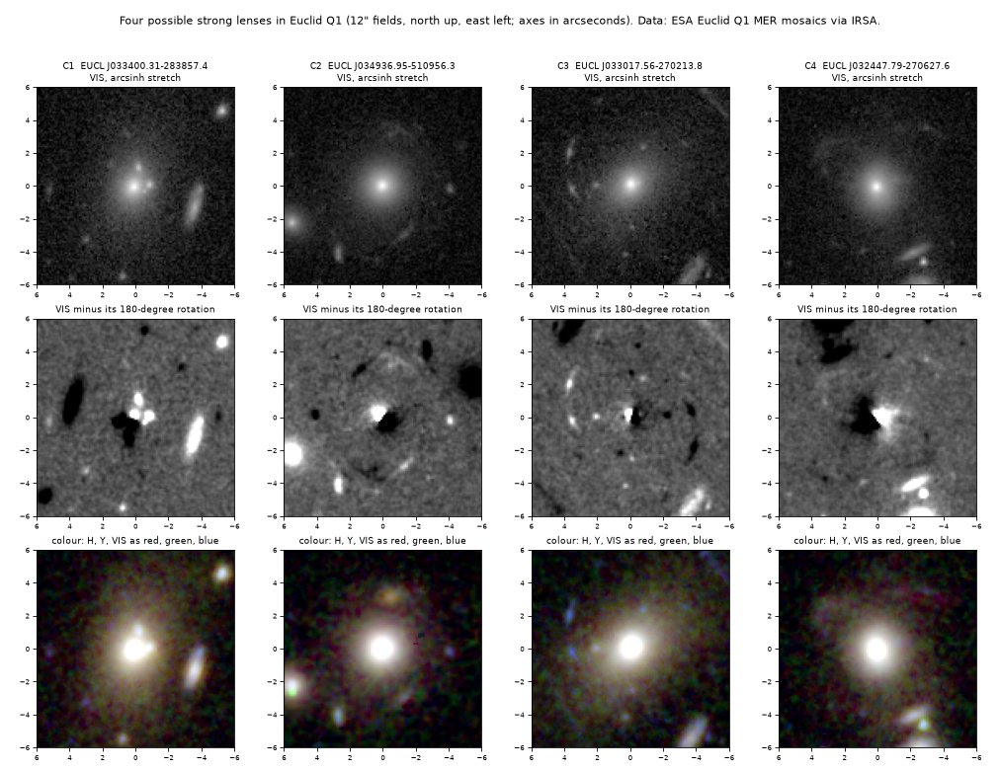

# Four possible strong gravitational lenses in Euclid Q1 imaging

Status: **candidates, not confirmed.** Two were graded plausible and two weak after a second look. A
third look on 2026-11-12 left one probable, two possible and one rejected (see the end of the page). No
spectra, no lens model. Produced with AI assistance; see the repository README.

## Source

Euclid Quick Release 1 (ESA, March 2025): VIS, NIR-Y and NIR-H mosaics of the Euclid Deep Fields, served
by IRSA. The Euclid consortium's own lens search on these data is the Strong Lensing Discovery Engine
(Walmsley et al. 2025 and companion papers), which published about 500 candidates and the list of every
object its experts inspected.

## How they were found

The first pass selected 6713 bright, smooth, concentrated galaxies from the Q1 catalogue (Zoobot "smooth"
score above 0.6, Sersic index above 2.5), removed everything within 3" of an entry in the published Q1
lens lists, subtracted a smooth elliptical model from each VIS cutout, ranked the galaxies by blue
residual light between 0.4" and 3.5", and looked at contact sheets of the top of the ranking. The
scoring was first tried on 36 known Q1 lenses.

## The candidates after the second look

Positions are of the lens galaxy (J2000).

| | name | RA, Dec (deg) | what is seen | grade here |
|---|---|---|---|---|
| C1 | EUCL J033400.31-283857.4 | 53.50131, -28.64928 | Two compact sources 1.0" west and 1.2" north-north-west of the centre of an elliptical galaxy, each above 80 sigma in a 0.5" box, and 1.5 and 2.2 times bluer than the galaxy core in VIS/H. | plausible |
| C3 | EUCL J033017.56-270213.8 | 52.57316, -27.03718 | A blue arc east of an elliptical galaxy in two segments at 3.6" and 4.3", 26 and 30 sigma, each longer along the circle than across it, 7 to 11 times bluer than the galaxy core; a blue knot at 2.0". No counter-image seen on the west side. | plausible |
| C2 | EUCL J034936.95-510956.3 | 57.40394, -51.16564 | Two faint arcs at 3.2" (south-south-west) and 3.5" (north) around a round elliptical galaxy, 24 and 21 sigma. Their colours differ: the southern one is bluer than the galaxy (1.8 times in VIS/H), the northern one redder (0.6). | weak |
| C4 | EUCL J032447.79-270627.6 | 51.19912, -27.10766 | A faint loop north-east of the galaxy. It looks more like a tidal shell than an arc. | weak |

*Top: VIS. Middle: VIS minus its own 180-degree rotation about the galaxy centre, which cancels a
symmetric galaxy without any model and leaves each asymmetric feature with a dark copy on the opposite
side. Bottom: colour from H, Y and VIS. Made by `check.py --figure` from Euclid Q1 data (ESA / Euclid
Consortium, via IRSA).*

What the second look changed. The first pass graded C1 and C2 plausible and two others weak. Here the
cutouts were fetched again from IRSA with separate code, and the features were measured without a
galaxy model. C1 stands. C3 is promoted: the arc is the most lens-like feature of the set. C2 is
demoted, because two images of one source must have the same colour and these do not. A fifth object
from the first pass (EUCL J035453.48-471621.8) is dropped: an entry of the Discovery Engine catalogue,
graded C there, lies 4.8" away in the same group of galaxies.

None of these is secure. For C1 the alternatives are two star-forming satellites or a chance pair of
faint stars; two images of one quasar would normally sit on opposite sides of the lens, not about 65 degrees
apart, so if this is a lens it is a four-image system with two images lost in the galaxy light. For C3
the alternative is a blue companion or tidal stream.

## How to check

    python check.py            (reads cutouts.npz; a few seconds)
    python check.py --figure   (also redraws candidates.png)

The script lists every residual feature with offset, size, significance, shape and colour, and asserts
the statements in the table. Output in `check.log`. Needs numpy and scipy; the figure needs matplotlib.

## Catalogues checked (2026-11-11)

- The Q1 Strong Lensing Discovery Engine lists on Zenodo: the lens catalogue (records 15003117 and
  15025832, including all 7354 expert-inspected objects), the "missed targets" list (17425610) and the
  bright low-redshift list (19260200): 10107 entries. Nearest entries: C1 94", C2 73", C3 220", C4 6.3"
  (a neighbouring galaxy that the experts inspected and graded as not a lens).
- lenscat, a community compilation of 32838 published lenses and candidates (it includes the DESI Legacy
  Surveys, DES and KiDS searches): nothing within 7 arcminutes of any of the four.
- Gaia DR3: no source within 5" of C1, C2 or C3, so the compact sources of C1 are below Gaia's limit and
  their motion cannot be tested.
- By the first pass: SIMBAD and NED within 10" (C1's galaxy is DES J033400.30-283857.3, listed as a
  galaxy in a cluster with no lens reference), and every VizieR catalogue within 10" (no lens table).

Not checked: the other Discovery Engine papers' internal lists where they are not on Zenodo; Euclid
DR1-era searches not yet public; citizen-science classifications that were never published; the HST and
JWST archives.

## What would settle it

A spectrum showing the blue features at one redshift behind the galaxy (for C1, two matching quasar or
galaxy spectra); or, for C3, deeper imaging that shows a counter-image; or a lens model that reproduces
the image positions.

## Third look (2026-11-12)

The four were rendered again from the ESA archive, with a different galaxy subtraction (the median
surface brightness in elliptical annuli, which does not mirror features to the opposite side as the
rotation method above does) and with colour from H, Y and VIS:

- **C3** stands as the best: a thin arc 3.6" east, curved around the galaxy and bluer than it in the
  composite. No counter-image. Probable.
- **C2**: a faint ring-like trace at about 3.5" whose pieces differ in colour; it could be a ring or shell
  of the galaxy. Possible.
- **C1**: two knots within 1", of about the galaxy's colour. Possible.
- **C4**: a tidal loop. Not a lens.

The Euclid Consortium's lens catalogue for Data Release 1 (ECLIPSE; Euclid Collaboration: Lines et al.
2026) does not cover the Q1 fields, so it says nothing about these four. SIMBAD and every VizieR
catalogue at the positions were checked again and hold no lens record. The search of the rest of DR1
is on the pages `candidates/astronomy/euclid-dr1-lens-candidates` and
`independent-rediscovery/astronomy/euclid-dr1-strong-lenses`.

## Data and credits

Euclid Q1 data: ESA and the Euclid Consortium, served by the NASA/IPAC Infrared Science Archive. Lens
lists: the Euclid Strong Lensing Discovery Engine team (Zenodo); lenscat (Vujeva et al.).
