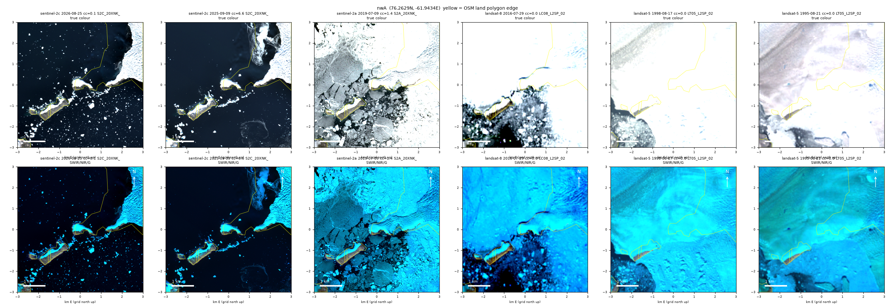
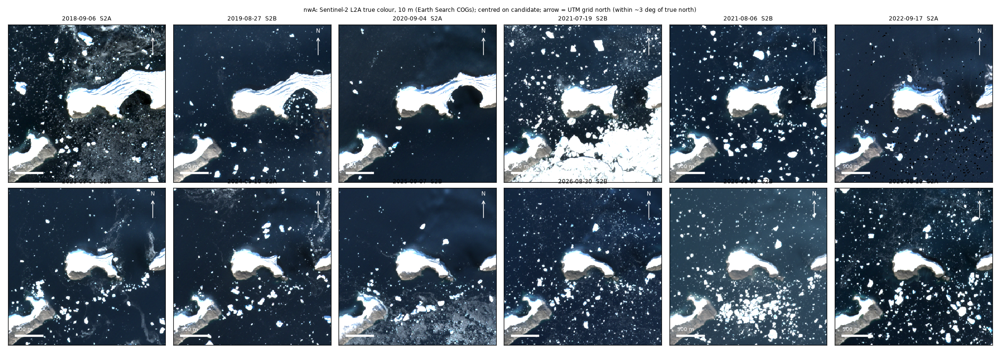
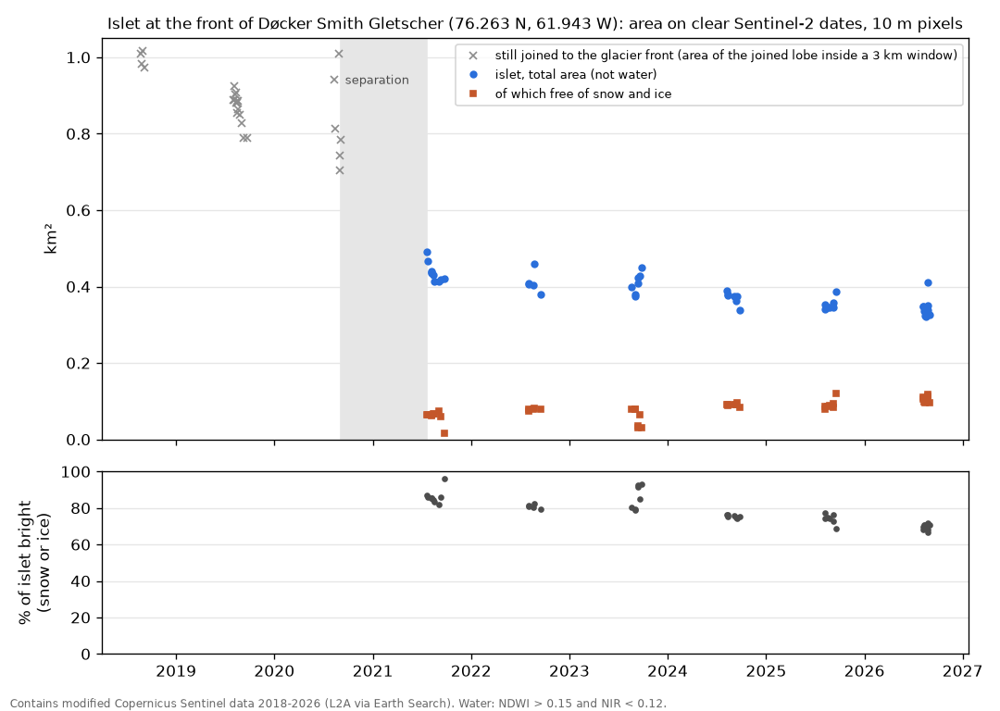
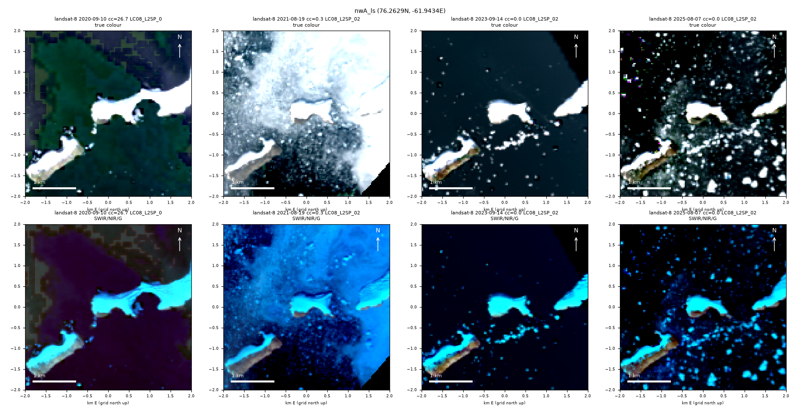

# An ice-capped islet at the front of Døcker Smith Gletscher, Melville Bay, has stood in open water since 2021

Status: **candidate** (a small new island for which no earlier report was found; the search for earlier
reports was limited, see below). Found in satellite imagery on 2026-11-11. Produced with AI assistance;
see the repository README.

## The source and what it says

OpenStreetMap, land polygons as downloaded on 2026-11-11, draws the coast of Melville Bay at the front
of Døcker Smith Gletscher (north-west Greenland) so that the feature described here is part of the
mainland: 72 % of its area lies inside the mainland polygon, joined to the ice sheet. The coastline ways
there carry no survey date. Landsat scenes of 21 August 1995 and 17 August 1998 show why: the glacier
then covered the site and ended south of it.

## The result

| | |
|---|---|
| position (centre, 2025 to 2026) | 76.2630 N, 61.9436 W |
| glacier | Døcker Smith Gletscher; its mapped front point (76.270 N, 61.906 W) is 1.3 km away |
| nearest named features | Kap Murdoch 14 km south, Kap Morris 13.5 km south-west, Morell Gletscher 16 km west, Rink Gletscher 22 km east |
| area in 2026 | 0.34 km² (median of 9 clear dates; 0.32 to 0.35 without the one date with a floe against the shore) |
| area in 2021 | 0.43 km² (median of 10 clear dates) |
| length | 1.0 to 1.15 km, west to east |
| free of snow and ice | 0.06 km² in 2021, 0.10 km² in 2026: a brown rim along the southern shore |
| last clear date joined to the glacier | 2020-09-04 (Sentinel-2); 2020-09-10 (Landsat 8) |
| first clear date surrounded by water | 2021-07-19 (Sentinel-2) |
| water to the nearest glacier ice, 2025 to 2026 | 0.5 to 0.6 km (median 0.57 km, 16 dates; measured to the ice body that reaches the east edge of the 3 km window) |
| water to the nearest mapped island (south-west) | about 0.6 km |
| height above the surrounding sea | 90th percentile 57 m in 2020 to 2022, 55 m in 2023 to 2024 (ArcticDEM strips) |

From 2018 to 2020 the feature was the tip of a lobe of the glacier front, joined by an ice bridge that
narrowed each year (figure 2). Since 19 July 2021 it is a separate body with open water or drifting
ice all round on 54 of 92 clear dates, through six summers. On the other 38 dates the non-water mask
reaches the edge of the window: 29 are in July, before the sea ice breaks up, and 9 in August have
packed floes or cloud that was not flagged. Those 9 were not each examined by eye; the dates shown in
figures 2 and 4 show no ice bridge after 2020.

Landsat 8, a different sensor at 30 m, shows the same: joined by the ice bridge on 10 September 2020
(`LC08_L2SP_028005_20200910_02_T1`), separate on 19 August 2021, 14 September 2023 and 7 August 2025.

## Rock or ice

Both. About 70 % of the surface was still bright (ice or snow) in August 2026, down from 86 % in 2021.
The total area shrinks by about 0.02 km² a year while the ice-free part grows, so the ice is melting
back off something that stays. In eight ArcticDEM strips from August 2020 to September 2024 the ice-free
southern rim stands 7 to 15 m (median) and up to about 30 m (90th percentile) above the sea, and the
ice-covered part stands 41 to 48 m (median). The ice surface dropped by 3 to 6 m in four years. A
body 55 m high whose bare rim reaches 30 m is a rock hill with an ice cap, not a stranded piece of
glacier tongue. The mapped island 0.6 km to the south-west looks the same: a bare southern rim under an
ice cap. How much of the 55 m is ice is not known. If all the ice goes, an island of at least
0.10 km² remains.

## How to check

`check.py` needs only the files in this folder. It re-measures three dates (joined, first isolated,
latest) from 10 m pixels with code independent of the series script, recomputes the yearly table and
the separation bracket from `area_series.csv` (251 scenes), and prints the DEM heights. Output is in
`check.log`.

The scenes can be opened by name in any Sentinel-2 browser: `S2A_20XNK_20200904_2_L2A` (joined),
`S2B_20XNK_20210719_3_L2A` (isolated), `S2B_20XNK_20260830_0_L2A` (latest).

Method. A pixel is water when NDWI (green, near infrared) exceeds 0.15 and near-infrared reflectance is
below 0.12. The islet is the connected non-water body at the centre of a 3 km window; it counts as
isolated when that body does not reach the window edge. The islet was first picked up by a separate
20 m search of whole tiles (water in any of three scenes of 24 to 26 August 2026), which gave
0.32 km².

## Limits

- The separation is bracketed only to ten months (10 September 2020 to 19 July 2021). All 84
  Sentinel-2 scenes between 5 September and 20 October 2020 and between 20 May and 18 July 2021 were
  fetched; sea ice and snow hide the channel in every clear one.
- Rock under the ice cap is inferred from height and from the bare rim, not observed.
- Areas depend on the water threshold and on the tide; dates with drift ice touching the shore were
  dropped (rule in `check.py`).
- Heights are relative to the median of the water surface around the islet in each strip, which can
  include small icebergs. Three cross-track strips from 2019 were tens of metres off and are left out.
- Only OpenStreetMap was compared. Danish and Greenlandic official maps and charts were not consulted,
  and the feature may be drawn correctly there.
- A second candidate 85 km to the west (76.236 N, 65.511 W, 0.25 km² of rock beside a glacier north of
  Savissivik) was rejected: at 10 m it is joined to the mainland on 110 clear dates and cut off by water
  on one (2024-09-25). The 20 m search had flagged it because it takes water from any of three scenes.

## Novelty check performed (2026-11-11)

Nothing found in any of these:

- glacierchange.blog (M. Pelto): the site's own search for "Docker Smith" and for "Melville Bay", and the
  tag "new-greenland-islands". The only mention is in "Rink Gletscher, Retreat NW Greenland" (22 November
  2013), which names the glacier as a neighbour. The list "Glacier Retreat Generating New Islands"
  (20 October 2017, updated 28 April 2024) has Upernavik, Kong Oscar and Steenstrup for Greenland.
- Kavan and others, "New coasts emerging from the retreat of Northern Hemisphere marine-terminating
  glaciers in the twenty-first century", Nature Climate Change 15 (2025): covers 2000 to 2020 and islands
  larger than 0.5 km². This islet separated after 2020 and is smaller, so it is outside that inventory by
  construction. The paper's data files were not opened.
- Ziaja and Ostafin, "Origin and location of new Arctic islands and straits due to glacial recession",
  Ambio (2018): published before the separation. Not read in full.
- Web searches in English and Danish for the glacier name (three spellings) with "island", "ny ø",
  "Kap Murdoch", "Melville Bugt"; a search for new Greenland islands 2021 to 2024; a Danish-language
  search for a new island in Melville Bugt (Qimusseriarsuaq), 2021 to 2025.
- Wikidata within 25 km and OpenStreetMap within 9 km: no named island at this position.

Not checked: the Greenland place-name register (Nunat Aqqi), Danish Agency for Data Supply maps,
nautical charts and notices, NASA Earth Observatory's archive beyond what the web searches return,
Greenlandic-language news, and the supplementary data of Kochtitzky and Copland (2022).

## Data and credits

Contains modified Copernicus Sentinel data (2018 to 2026), read from the Earth Search catalogue. Landsat
imagery courtesy of the U.S. Geological Survey. ArcticDEM strips: Polar Geospatial Center (Porter and
others), from Maxar imagery. Copernicus DEM GLO-30 was used to reject terrain shadow. Coastline:
OpenStreetMap contributors. Place names: Wikidata.
