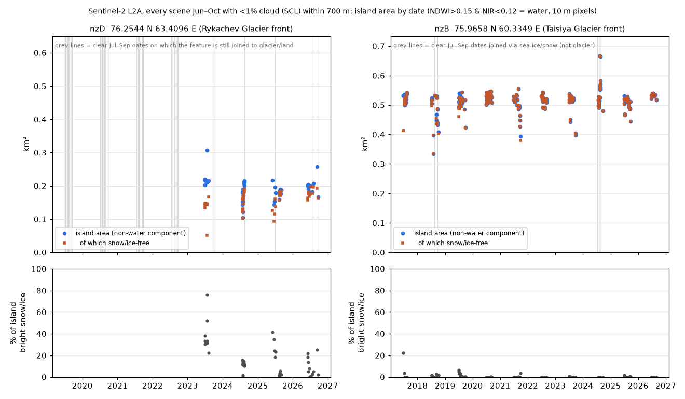
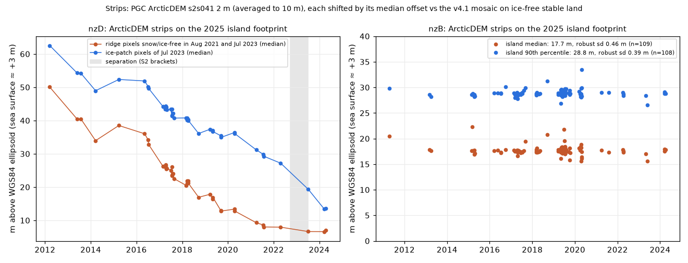

# Three Arctic islands exposed by glacier retreat

Status: **rediscovery** (all three). Found independently in satellite imagery on 2026-11-11, then traced
to earlier reports. Credit belongs to the people named below. Produced with AI assistance; see the
repository README.

## What was done

Late-summer Sentinel-2 scenes of the Russian Arctic were compared with the OpenStreetMap coastline to
find land that maps draw as attached, through a glacier, and that now stands in open water. The search
recovered 215 islands that are already mapped (areas matching closely) and three that are not on
OpenStreetMap. All three turned out to be known.

| | position | area | separated | first reported by |
|---|---|---|---|---|
| Rykachev Glacier front, Novaya Zemlya | 76.2544 N, 63.4096 E | 0.19 ± 0.02 km², a ridge 1.1 km long | between 2022-09-24 and 2023-07-02 | Russia's Northern Fleet and the Russian Geographical Society, announced 18 October 2023 ("an island near Zayachya Bay at the Rykachev glacier"); also shown by M. Pelto, glacierchange.blog, 28 November 2025 |
| Taisiya Glacier front, Novaya Zemlya | 75.9658 N, 60.3349 E | 0.52 ± 0.02 km² | between 2006 and 2011 | M. Pelto, "Taisija Glacier Retreat, Novaya Zemlya", 21 July 2013 (matched by coastline shape, not by coordinates) |
| Cape Leiter, Graham Bell Island, Franz Josef Land | 80.6447 N, 63.0427 E | 0.22 km² | between 2022-08-01 and 2023-08-01 | Northern Fleet hydrographers, announced July 2022 |

## What the measurements add

These are measurements of known islands, offered as a check on the published descriptions.

- **Rykachev island: rock or sediment, not ice.** Area was measured on 39 clear dates. The total shrank
  from 2023 to 2025 while the ice-free part grew from 0.145 to 0.19 km²: a stranded patch of glacier ice
  melted off a stable ridge. In 49 co-registered ArcticDEM strips the ridge surface changed by less than
  half a metre between July 2021 and April 2024, while the ice patch dropped 15 m. The ridge is low:
  median height about 3 to 4 m above the sea.
- **Taisiya island: bedrock.** Area shows no trend over 262 clear dates from 2017 to 2026, and the
  surface height (median 17.7 m in 109 strips, 2011 to 2024) has not changed.
- **Separation dates** for the Rykachev island are bracketed more tightly than the announcement gives:
  every Sentinel-2 scene from June to October, 2019 to 2026, was examined (438 scenes).

## How the earlier reports were missed at first

Official announcements of this kind name a bay and a glacier and give a rough size, but no coordinates,
and they rarely reach OpenStreetMap, GeoNames or Wikidata. "Not on the map" therefore says little. The
first of the three (Cape Leiter) was briefly taken for a new find from the imagery alone; the search of
Russian-language news is what settled all three.

## Limits

- The match of the Rykachev island to the 2023 announcement rests on its wording (bay, glacier, size,
  date, ice cover), not on coordinates. The match of the Taisiya island to the 2013 post is by eye.
- A slowly melting ice core under the debris of the Rykachev ridge cannot be excluded with one
  elevation pair after separation.
- Not searched: Greenland, the Canadian Arctic, Alaska, Patagonia, South Georgia, Antarctica.

## Data and credits

Contains modified Copernicus Sentinel data (2017 to 2026). Landsat imagery courtesy of the U.S.
Geological Survey. ArcticDEM: Polar Geospatial Center (Porter et al.), DEMs created from Maxar imagery.
Coastline: OpenStreetMap contributors.
