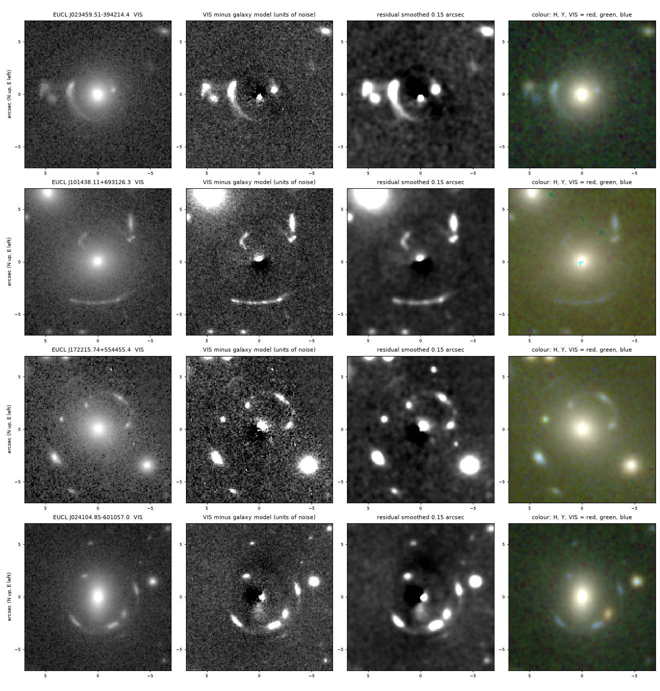

# 93 strong-lens candidates in Euclid DR1, found independently on release day and all in the consortium's catalogue

Status: **rediscovery.** Every object here is in the Euclid Consortium's ECLIPSE strong-lens catalogue,
published with the release. Produced with AI assistance; see the repository README.

## Who had it first

Euclid Collaboration: Lines et al. (2026), "Euclid Data Release 1 (DR1). Euclid Lens Identification
Pipeline and Scientific Exploration (ECLIPSE) A: Strong Lens Catalogue Overview", with the catalogue on
Zenodo (doi 10.5281/zenodo.19654904): 15,072 sure or probable lens candidates and 9,010 possible ones in
about 2,000 square degrees, found with five neural networks, about 7,000 volunteers and 67 experts. Five
of the 93 were published even earlier, by Stein et al. (2022), Garvin et al. (2022) and Storfer et al.
(2026), as the consortium's catalogue records.

## What was found here

On 2026-11-12, the day Euclid DR1 became public, 14,986 bright red galaxies in 1,305 tiles were graded by
eye by AI models for arcs and rings (the method is on the page
`candidates/astronomy/euclid-dr1-lens-candidates`). 159 were kept. 93 of them are in the consortium's
object catalogue: 92 at the same position and one, a triple of galaxies with one arc, centred on a
different member 2.5 arc seconds away. `rediscoveries.csv` lists them with the consortium's identifier,
grade and expert score.

*The four objects graded highest here: EUCL J023459.51-394214.4, J101438.11+693126.3,
J172215.74+554455.4 and J024104.85-601057.0. They are EUCL-DR1-L014353, L001578, L005897 and L020291 in
the consortium's catalogue, graded A, A, B and A by its experts. Columns: Euclid VIS; VIS minus a smooth
model of the galaxy; the same smoothed; colour from H, Y and VIS. 14 arc seconds across, north up, east
left. Euclid DR1 data (ESA / Euclid Consortium). The figure was made with the code of the candidates
page from cutouts that are not stored here, so `check.py` does not redraw it.*

## How the two gradings compare

| grade here | consortium A | B | C | rejected | total |
|---|---|---|---|---|---|
| A | 3 | 1 | 0 | 0 | 4 |
| B+ | 8 | 21 | 1 | 0 | 30 |
| B | 21 | 27 | 10 | 1 | 59 |
| all | 32 | 49 | 11 | 1 | 93 |

- The consortium's experts graded 81 of the 93 (87 per cent) as sure or probable lenses, 11 as possible
  and 1 as not a lens.
- The search here was far less complete than theirs. Among the 14,986 galaxies graded here, the
  consortium's catalogue has 310 sure or probable lenses; 80 of them ended in the list here (26 per cent).
  The first-stage graders flagged 65 per cent of the consortium's grade A lenses and 53 per cent of its
  grade B lenses at some grade.
- The final review by the lead model was the main loss. 114 of the consortium's sure or probable lenses
  reached it, and it rejected 34, mostly small rings and crescents within about one arc second of the
  galaxy centre, which it took for artefacts of the galaxy subtraction.
- The grades given here ran lower than the experts': of the 59 objects graded only B here, the experts
  called 21 sure lenses.

## How the earlier work was missed

The results were first reported as having no record in public catalogues. The checks made were a
community compilation of published lenses, the Q1 lens lists, SIMBAD, NED, VizieR, the arXiv listing and
a web search. The consortium's catalogue was in none of them on the day: its papers were on the
consortium's own server and linked from the release's papers page, and its data were on Zenodo. The
release page itself said "around 15 000 strong gravitational lensing candidates". Reading the release's
own contents and papers pages first would have found it.

## How to check

    python check.py

It verifies that every row matches a consortium identifier, the table above, and the 87 per cent.
Output in `check.log`. A separate AI model, acting as referee, redid the cross-match from the consortium's
object catalogue and found the same 93.

## Data and credits

Euclid DR1: ESA and the Euclid Consortium. ECLIPSE catalogue: Euclid Collaboration: Lines et al. (2026)
and companion papers (Holloway et al., Nightingale et al., Nersesian et al.); Zenodo
10.5281/zenodo.19654904.
