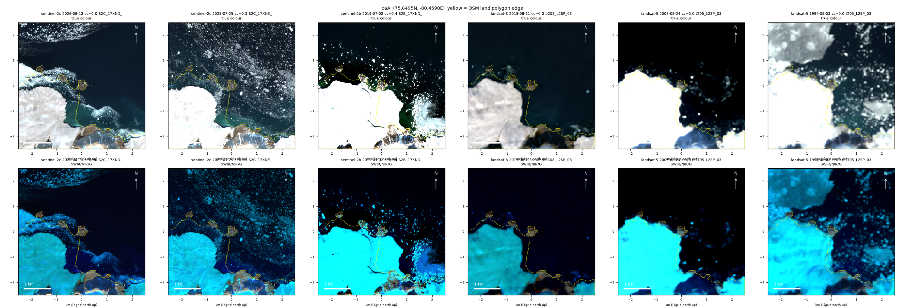

# The rocky points of Cape Caledon, Devon Island, are islands: a search of new coasts found them again

Status: **rediscovery**. Found independently in satellite imagery on 2026-11-11, then traced the same
day to M. Pelto's report of 2018. Credit belongs to him. Produced with AI assistance; see the repository
README.

## The earlier report

M. Pelto, "Three New Islands Released from Devon Ice Cap, Canada", glacierchange.blog, 4 September 2018
(updated 27 April 2024), comparing Landsat images of 2000, 2002, 2017 and 2018:

> "By 2017 the glacier has separated from the three rocky Points on the northern margin, each is now a
> new island."

> "Today the Cape Caledon Glacier no longer reaches these rocky Points that have now become islands."

The post gives no coordinates or sizes. The match made here rests on its description: three rocky
points on the northern margin of a glacier of the Devon Ice Cap east of Belcher Glacier, on Lady Ann
Strait.

## What was found here

A search for land that OpenStreetMap draws as attached and that Sentinel-2 shows in open water (method
on the page `dead-ends/geography/glacier-islands-survey`) flagged two bodies on the north coast of
Devon Island in scenes of August 2026:

| | position | area |
|---|---|---|
| eastern islet | 75.6495 N, 80.4590 W | 0.10 km² |
| middle islet | 75.6520 N, 80.4856 W | 0.06 km² (20 m pixels, one composite) |

A third knob about 0.9 km further west still had glacier ice or brash against it in the scenes used and was
not separated by the detector. OpenStreetMap, as downloaded on 2026-11-11, draws all three as part of
Devon Island, along the old ice front.

## What the measurements add

- **The eastern islet is rock and has not changed.** On 86 clear Sentinel-2 dates from 25 August 2018
  to August 2026 it is surrounded by water, with a yearly median area between 0.094 and 0.117 km² and
  no trend (all dates: 0.102 km²). It is free of snow and ice in August.
- **The glacier has moved on.** In the Landsat scenes of 1994 and 2003 the ice reaches the knobs. In
  August 2026 open water extends roughly 1 km behind the eastern islet (figure).

## How to check

`check.py` recomputes the yearly areas from `area_series.csv` (one row per Sentinel-2 scene; 337 scenes,
134 clear). Output in `check.log`. Scene to look at: `S2C_17XND_20260813_0_L2A`.

## Limits

- The match to the 2018 post is by description, not by coordinates.
- Only the eastern islet has a time series. The middle islet has one measurement at 20 m.
- The first Sentinel-2 Level-2A scenes in the catalogue used are from July 2018, so these data do not
  date the separation; Pelto's Landsat comparison puts it before 2017.
- Distances to the ice front are read from the figure, not measured.

## Data and credits

Contains modified Copernicus Sentinel data (2018 to 2026). Landsat imagery courtesy of the U.S.
Geological Survey. Coastline: OpenStreetMap contributors.
