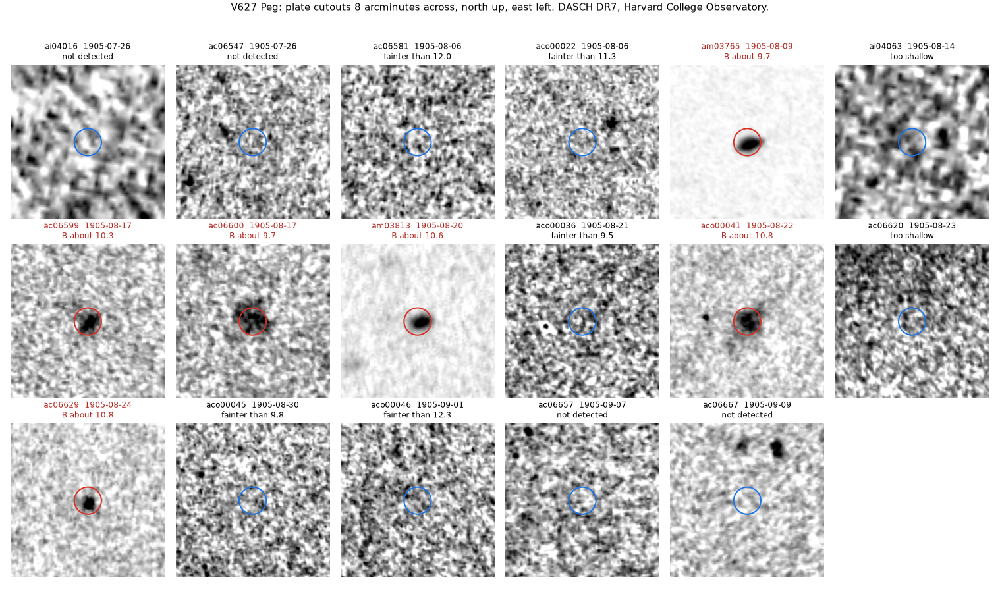
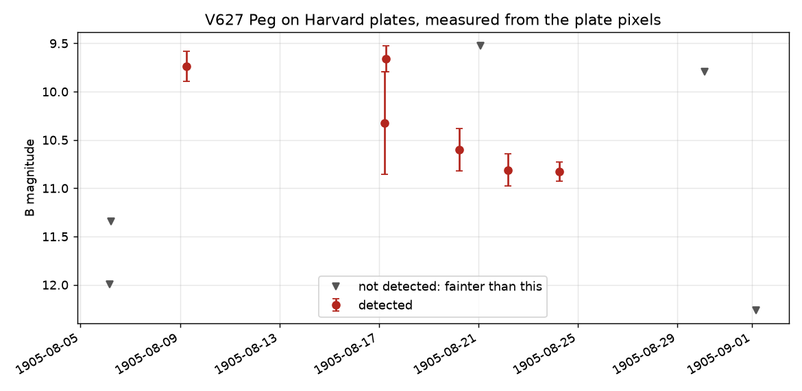

# V627 Peg: an outburst in August 1905 on Harvard plates

Status: **verified on the plates; no earlier report found** (2026-11-11). Not examined by a specialist,
not refereed, and not reported to anyone. Produced with AI assistance; see the repository README.

## The star

V627 Peg (OT J213806.6+261957) is a dwarf nova of the WZ Sge type, 99 parsecs away: a white dwarf
pulling gas from a small companion through a disc. The disc fills for years and then empties onto the
white dwarf in a few weeks. The star sits near magnitude 16 and reaches magnitude 9 in outburst.

It was discovered in outburst in 2010. The outbursts on record are:

| year | source |
|---|---|
| 1942 | R. Hudec, [ATel 2619](https://www.astronomerstelegram.org/?read=2619): found on Sonneberg plates; more than 3000 plates from 1928 to 2004 showed no other |
| 2010 | discovery (CBET 2273, 2275); Kato et al. 2010 |
| 2014 | Kato et al. 2015 |
| 2021 | Tampo et al. 2023, PASJ 75, 619, which lists the three above as all that had been reported |

## Result

Six Harvard patrol plates taken from 9 to 24 August 1905 show a star at the position of V627 Peg at
about magnitude 9.5 to 10.8, six magnitudes above its normal level. Plates three days earlier and
eight days later show nothing there.

*Red circles: the star is there. Blue circles: it is not. "Too shallow" marks plates on which even a
9.5-magnitude comparison star is missing.*

| date (UT) | plate | DASCH pipeline, B | this check, B | this check, bracket |
|---|---|---|---|---|
| 1905 Aug 6.17 | ac06581 | not detected, limit 12.2 | fainter than 12.0 | |
| 1905 Aug 6.23 | aco00022 | not detected, limit 11.4 | fainter than 11.3 | |
| **1905 Aug 9.26** | **am03765** | **9.15** | **9.74 ± 0.16** | 9.5 to 9.8 |
| 1905 Aug 14.23 | ai04063 | not detected, limit 9.0 | plate too shallow | |
| **1905 Aug 17.21** | **ac06599** | **9.58** | | 9.8 to 10.9 |
| **1905 Aug 17.27** | **ac06600** | **9.45** | | 9.5 to 9.8 |
| **1905 Aug 20.24** | **am03813** | **10.13** | **10.60 ± 0.22** | 9.8 to 10.6 |
| 1905 Aug 21.09 | aco00036 | no calibration | plate reaches only 9.5 | |
| **1905 Aug 22.17** | **aco00041** | **10.42** | **10.81 ± 0.17** | 10.6 to 10.9 |
| 1905 Aug 23.15 | ac06620 | no calibration | plate too shallow | |
| **1905 Aug 24.24** | **ac06629** | **10.29** | **10.83 ± 0.09** | 10.6 to 11.1 |
| 1905 Aug 30.11 | aco00045 | no calibration | plate reaches only 9.8 | |
| 1905 Sep 1.17 | aco00046 | not detected, limit 12.4 | fainter than 12.3 | |

The six detections come from three plate series (AM, AC and ACO), which are different cameras.

Read as a light curve: a rise of more than two magnitudes in at most three days, a slow fade of about
1.1 magnitudes over the next fifteen days, and then a drop of at least 1.5 magnitudes within eight
days. The event lasted between 15 and 26 days. That is the shape of a WZ Sge-type superoutburst, and
it matches the 1942 event (magnitude 9.8 ± 0.5 at peak, 12 to 46 days long). The true maximum fell in
the gap between 6 and 9 August and may have been brighter than anything measured.

## Two measurements

1. **The DASCH pipeline.** An agent found the event in the DASCH DR7 light curve of the star, which
   holds the Harvard project's own photometry of every plate, and then looked at the plate images.
2. **The plate pixels, with separate code.** `check.py` downloads a cutout of every plate that covers
   the position from 25 June to 10 October 1905 (48 plates) and measures the image at the position
   without using the DASCH photometry. The image stands 9 to 71 times above the plate noise on the
   same six plates and on no others; the largest value on the other 42 plates is 2.7. Magnitudes come
   from isolated catalogue stars on the same plate (Tycho-2 and APASS), by a straight-line calibration
   where enough of them are detected, and always by a bracket: the comparison stars whose images are
   just stronger and just weaker than the target's.

The two agree on which plates show the star and on its fading. The second measurement is fainter by
0.3 to 0.6 magnitudes. It is the cruder of the two (a fixed aperture and a straight line through a
few stars), and patrol plates are good to about half a magnitude at best, so the pipeline values are
the ones to quote.

## Control: the known 1942 outburst

    python check.py 1942-11-10 1943-01-05 out_1942

The same script, pointed at the weeks around the outburst that Hudec found on Sonneberg plates, finds
the star on six Harvard plates out of 35:

| date (UT) | plates | this check, B |
|---|---|---|
| 1942 Dec 1.03 and 1.07 | fa07195, fa07196 | between 9.5 and 9.8 |
| 1942 Dec 5.97 | ai37965 | 10.19 ± 0.05 |
| 1942 Dec 8.96 to 9.05 | fa07233, fa07234, fa07235 | 10.6 to 10.7 |

Sonneberg gave an outburst from 30 November to 11 December 1942 with a peak of 9.8 ± 0.5. Date and
brightness agree, so the method does find a real outburst of this star on these plates. By the same
yardstick the 1905 event (9.7 on its first plate) was about as bright as the 1942 one. One further
plate, on 4 December, gives a marginal signal 12 arcseconds off the position on a plate too shallow to
calibrate; it is not counted. Results in `plates_1942.csv` and `check_1942.log`.

## Why it is this star

- **Not a plate flaw.** Six plates, three cameras, fifteen days.
- **Not an asteroid.** The image does not move in fifteen days, and the JPL small-body identification
  service lists no known asteroid brighter than magnitude 16 within 3 arcminutes at any of the six
  times.
- **Not a neighbour.** The AAVSO index has no other variable within 7 arcminutes that gets brighter
  than magnitude 13. The nearest catalogued star brighter than B = 14 is 55 arcseconds away, at 13.9.
- **Position.** The centre of the image falls 1 to 7 arcseconds from the catalogue position. Comparison
  stars on the same plates fall 1 to 3 arcseconds from theirs, and one pixel of the original scans is
  about 7 arcseconds for these cameras.
- **Behaviour.** The same star is known to do exactly this.

## Novelty check

Checked 2026-11-11:

- the star's entry in the AAVSO Variable Star Index, with its remarks and reference list (no outburst
  before 1942 mentioned);
- ATel 2619 and the 2023 paper above, which give 1942 as the only outburst known before 2010;
- two in-depth web searches with both names of the star and "1905", "Harvard", "DASCH", "plates";
- other plate archives, for an independent image: the Heidelberg archive (HDAP), the APPLAUSE archive
  (Potsdam, Hamburg, Bamberg and others) and the Wide-Field Plate Database, all through the GAVO data
  centre. None lists a plate of this field between 1 August and 2 September 1905. Sonneberg's patrol
  begins in the 1920s. As far as these indexes show, Harvard's plates are the only record.

What this cannot rule out: a mention in mailing-list archives that search engines do not index
(vsnet, AAVSO forums), or knowledge inside the DASCH team that was never published.

## What it adds

Hudec's 1942 find was read as showing that this star's outbursts are extremely rare, about one in 67
years. Then it erupted in 2010, 2014 and 2021. With 1905 the list is 1905, 1942, 2010, 2014, 2021: gaps
of 37, 68, 4 and 7 years, as far as the records go. Plate coverage has seasonal gaps every year, so
outbursts may be missing from the first two gaps.

## What would settle it

- A look at the original glass and the observing logbooks at Harvard, which the DASCH team can do.
- A specialist's reading. The people who study this star are in the VSNET collaboration (Kyoto) and
  the AAVSO.

## Reproducing

    pip install -r ../../../requirements.txt
    python check.py 1905-06-25 1905-10-10 out_1905

The first run downloads about 110 cutouts and takes about half an hour; the DASCH service is slow and
sometimes refuses requests, and the script waits and retries. Results from the run on 2026-11-11 are
in `plates_1905.csv` and `check_1905.log`.

## Data and credits

This work has made use of data provided by Digital Access to a Sky Century @ Harvard (DASCH), which has
been partially supported by NSF grants AST-0407380, AST-0909073, and AST-1313370. Work on DASCH Data
Release 7 received support from the Smithsonian American Women's History Initiative Pool. The plates
are from the Harvard College Observatory's Astronomical Photographic Glass Plate Collection.

Catalogues: Tycho-2 and APASS DR9 through VizieR (CDS, Strasbourg, and its Harvard mirror); the AAVSO
International Variable Star Index; JPL's small-body identification service; plate archive metadata
through the German Astrophysical Virtual Observatory.
